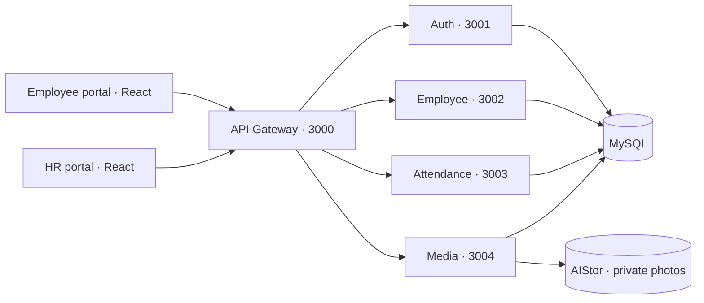

# Employee Attendance System

A full-stack attendance platform with separate employee and HR portals. Employees record attendance with a photo and device location; HR manages employee accounts, holidays, attendance records, and daily monitoring.

Built as a TypeScript monorepo with **React**, **five NestJS microservices**, **MySQL**, and private S3-compatible photo storage.

## Local access

The hosted demo is no longer available because its server subscription has ended.
Run the backend, database, storage, and both portals locally using the [local setup guide](docs/getting-started.md).
These addresses are available after starting the applications on your own computer:

| Portal | Local URL | Login |
| --- | --- | --- |
| HR | [localhost:5174](http://localhost:5174) | Seeded local HR account: `admin@example.test` |
| Employee | [localhost:5173](http://localhost:5173) | Employee account created through the local HR portal |

The initial HR password is generated during setup and stored in `ADMIN_SEED_PASSWORD` in your private `.env.auth` file. Employee temporary passwords are shown once during account creation. Change the initial password after login. The previous hosted demo accounts and historical database are not included in a clean clone.

Camera and location permissions are required for recording new attendance. Use `localhost` consistently for browser access, cookies, and allowed origins. The local API is `http://localhost:3000/api/v1`; private photo storage runs at `http://localhost:9000`.

## Features

| Employee portal | HR portal |
| --- | --- |
| Role-specific login and password change | Dashboard and daily attendance monitoring |
| Today's attendance and schedule | Employee creation, editing, activation, archive, and restore |
| Check-in/check-out with photo and location | Account provisioning and temporary password reset |
| One-face detection, blink capture, manual fallback | Department and position management |
| Photo preview and retake | Holiday calendar management |
| Late/early departure reasons | Search, filters, pagination, and historical records |
| Personal history and private photo access | Attendance details with photos and Leaflet maps |
| Retry and uncertain-result handling | Attendance soft delete/restore with reasons and audit |

See the [feature guide](docs/features.md) for role boundaries. Face detection assists capture; the application does not perform biometric identity matching or geofencing.

## Architecture



Each backend runs as a separate process/container with its own API and table ownership. One MySQL database has service-specific users and restricted grants; services exchange data through HTTP rather than querying each other's tables. Durable operations and an outbox support retries across service boundaries.

| Layer | Technology |
| --- | --- |
| Frontend | React 19, TypeScript, Vite, HeroUI, shared custom components |
| Backend | NestJS, REST APIs, JWT sessions, bcrypt |
| Database | MySQL 8.4, Prisma 7, versioned SQL migrations |
| Photo storage | MinIO AIStor Free, private buckets, temporary signed URLs |
| Capture/maps | MediaPipe Tasks Vision, browser Geolocation, Leaflet |
| Tests | Jest, Vitest, React Testing Library; focused integration tests when needed |
| Delivery | GitHub Actions, GHCR, Docker Compose, Ubuntu/Nginx, Vercel, Cloudflare |

Read the [architecture](docs/architecture.md) and [database/ERD](docs/database.md).

## Run locally

Requirements: Node.js **24.x, minimum 24.15.0**, pnpm **10.28.0**, Git, Docker Compose, and an AIStor Free license for the photo service.

```sh
git clone https://github.com/annastriw/employee-attendance-system.git
cd employee-attendance-system
git switch dev
npm install --global pnpm@10.28.0
pnpm install --frozen-lockfile
```

Follow the [local setup guide](docs/getting-started.md) for private environment files, MySQL/AIStor, migrations, a local HR account, and the seven applications. A clean clone does not include a database snapshot, private credentials, or an AIStor license. Local credentials are generated separately.

## Development and delivery

```text
dev locally → focused unit tests → manual UI check → push dev
→ PR dev to main → CI → merge → Vercel / VPS automatic deployment
```

`dev` is the development branch and `main` contains reviewed releases. The diagram describes the original delivery workflow; hosted operation is currently unavailable. Vercel/VPS deployment guides remain as references for provisioning your own infrastructure. Use the local setup guide to run the application now.

Development uses **Specification-Driven Development (SDD)** and a **Kanban workflow**: define rules and contracts, implement one complete feature, verify the changed logic, review manually, then release. See [development](docs/development.md) and [deployment](docs/deployment.md).

## Repository

```text
apps/          two React portals and five NestJS services
packages/      shared UI and database client wrapper
prisma/        schema and SQL migrations
infra/         Compose, Docker images, proxy and deploy configuration
scripts/       local setup, database grants, demo importer, deployment
docs/          guides, architecture decisions, module specifications
tasks/         roadmap and accepted feature status
```

## Documentation

- [Requirements analysis](docs/requirements/analysis.md)
- [Product requirements](docs/requirements/prd.md)
- [SDD lifecycle: requirements to automatic deployment](docs/sdd/lifecycle.md)
- [Local setup](docs/getting-started.md)
- [Features and demo walkthrough](docs/features.md)
- [Architecture and service boundaries](docs/architecture.md)
- [Database design and ERD](docs/database.md)
- [API reference](docs/api.md)
- [Development: SDD, Kanban, tests, and Git](docs/development.md)
- [Deployment and automatic releases](docs/deployment.md)
- [Module specifications](docs/sdd/README.md)
- [Frontend finalization and verification record](docs/development/finalization.md)
- [Security and audit scope](docs/security.md)

Private environment files, tokens, deployment keys, licenses, backups, and photo data are excluded from Git. Local passwords are generated during setup and must stay private.
